

  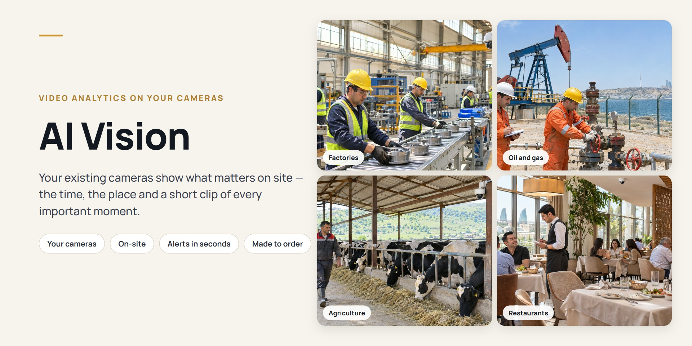

# AI Vision — video analytics on your existing cameras

**The cameras already on your site show what matters: the time, the place and a short clip of every important moment — and an alert within the minute when something needs a person.** Everything runs on site; camera footage stays with you.

One core, many scenarios: places, dwell time, presence, line crossing, repeated actions and camera health are shared building blocks. A new site is a new scenario configuration, not a new product. First deployed at the cash desk of a bakery-café chain.

Product page: [sci-fi.az/en/products/ai-vision](https://sci-fi.az/en/products/ai-vision)

## Directions

<table>
<tr>
<td width="50%">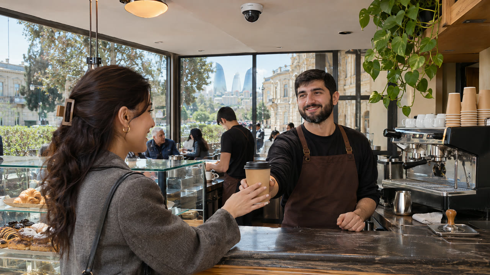 <b>Cash and till</b> · <i>pilot</i> Hand-outs without a receipt, incorrect change, items deleted after hand-out.</td>
<td width="50%"> <b>Warehouses</b> Receiving and dispatch by fact, pallet and box counts, a forklift in a pedestrian zone.</td>
</tr>
<tr>
<td>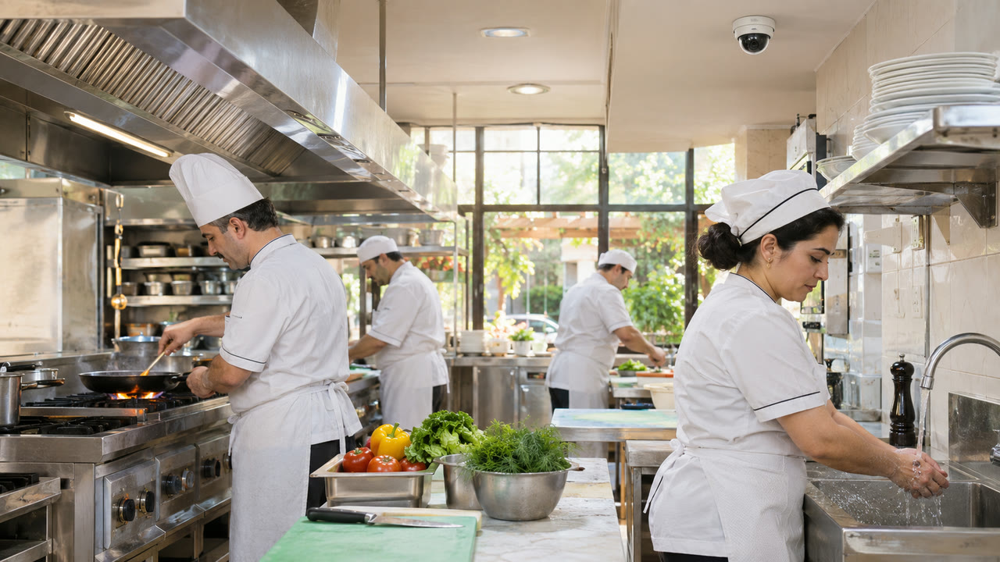 <b>Staff actions</b> Post staffed, order of operations, workwear and protective gear, idle time.</td>
<td>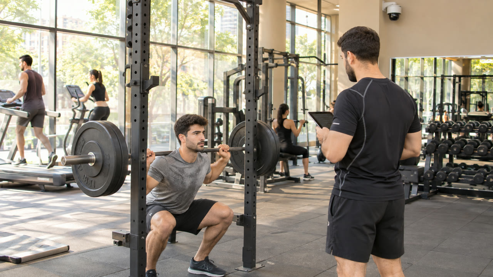 <b>Training</b> Rep counts, pace and how each exercise is performed.</td>
</tr>
<tr>
<td> <b>Emergencies</b> A person falling, a fight, smoke and fire, someone in a danger zone.</td>
<td>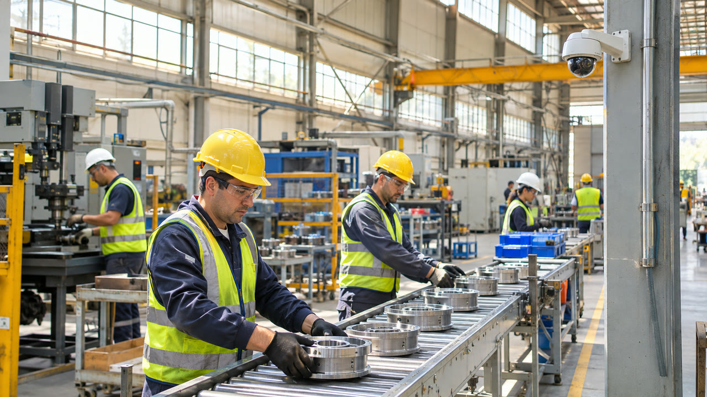 <b>Factories</b> Output and rejects without sensors on the line, line stoppages, people at dangerous machinery.</td>
</tr>
<tr>
<td> <b>Oil and gas</b> People in danger zones, outsiders on the perimeter, vehicle log, dispatch checked against waybills.</td>
<td>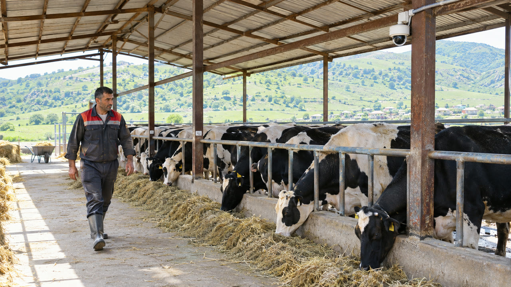 <b>Agriculture</b> Herd counted out to pasture and back, time at feeders and troughs, storage and machinery at night.</td>
</tr>
<tr>
<td>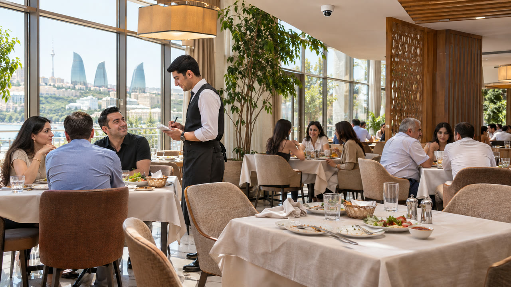 <b>Restaurants and cafés</b> Guests waiting for a waiter, table turnover, tables waiting to be cleared, busy hours.</td>
<td> <b>Hotels</b> Reception left unattended, free parking spaces, housekeeping time per room, breakfast load. No cameras in rooms.</td>
</tr>
<tr>
<td>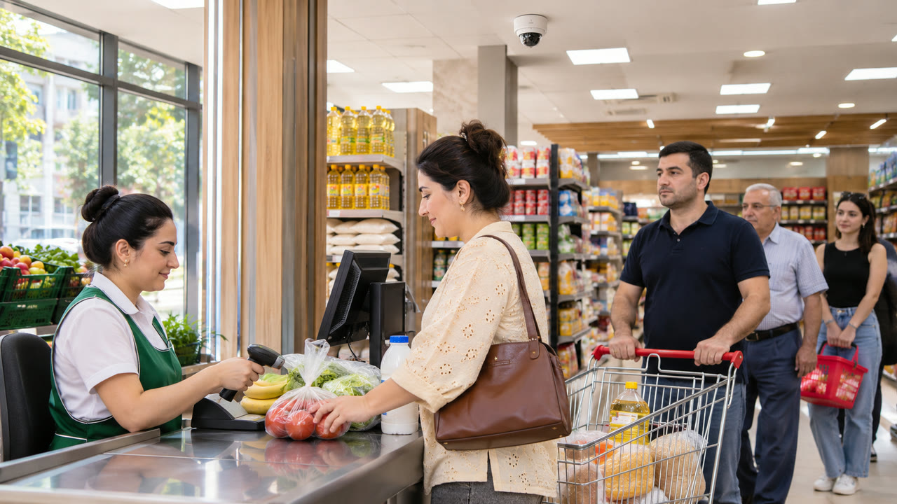 <b>Retail</b> Open a second till when the queue grows, footfall against receipts, empty shelves.</td>
<td>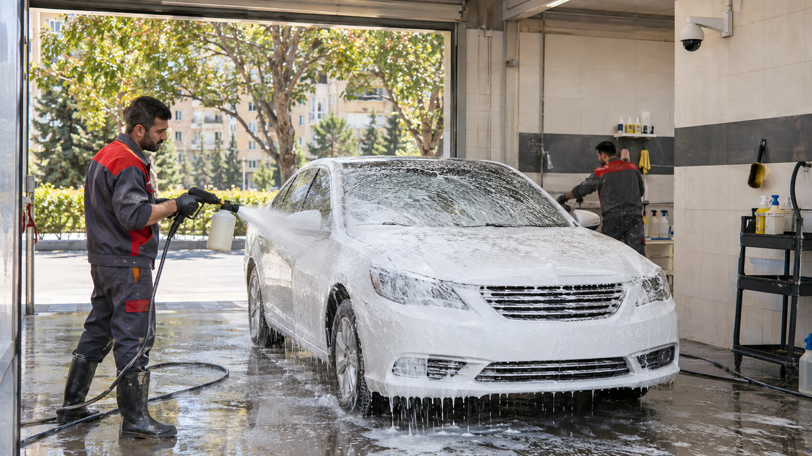 <b>Car washes and service</b> Busy and free bays, time per car, cars against receipts, cars waiting at the gate.</td>
</tr>
</table>

Everything except the cash desk is set up to order: we look at your cameras, test on your footage and agree the moments that matter before a pilot.

## How it works

1. **Camera** — your cameras; new hardware only if the angle doesn't fit.
2. **What matters** — the camera spots a drink, a person, a vehicle or smoke.
3. **No duplicates** — the same object is tracked and counted once.
4. **Check** — place, time and order of actions decide whether a moment matters.
5. **Message** — time, place and a short clip; important moments reach a phone.

## First deployment: the cash desk

Running as Cup Detector at a bakery-café chain: cameras above the hand-out zone count every drink, match each one with the POS receipts, re-check the shift overnight from a second recording and give the owner a review page for every mismatch.

All screenshots use demo data for a fictitious café; camera frames are synthetic images without people. The interface is shown in Russian.

**Reconciliation** — what the camera counted, what the till confirmed, what the recording re-check confirmed, and what is left for a human to review.

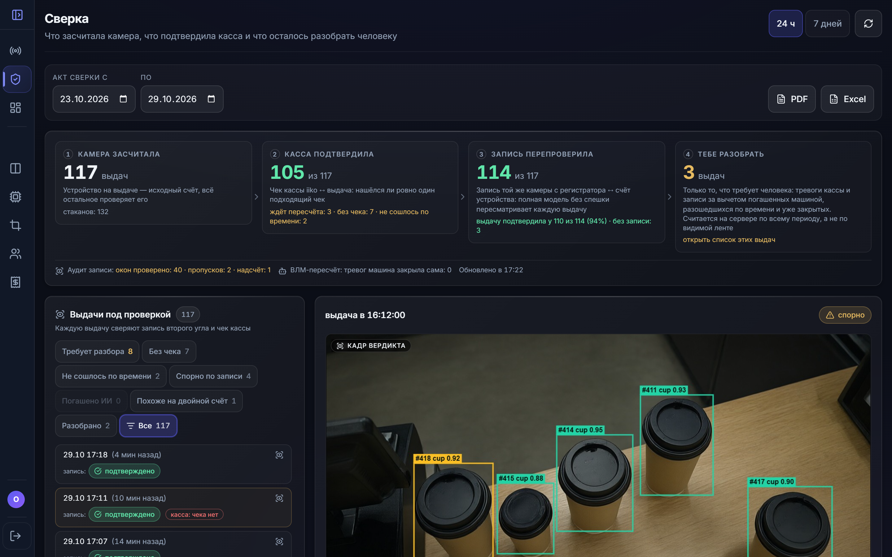

**Discrepancy review** — a cup handed out without a receipt: verdict frame, receipt lookup and resolution.

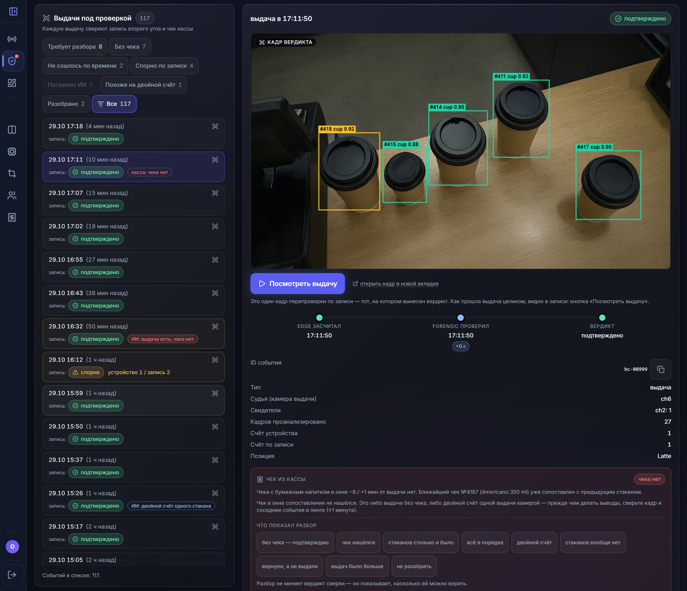

**Owner dashboard** — today's hand-outs, second-angle confirmation rate, audit gaps, system health and the daily digest.

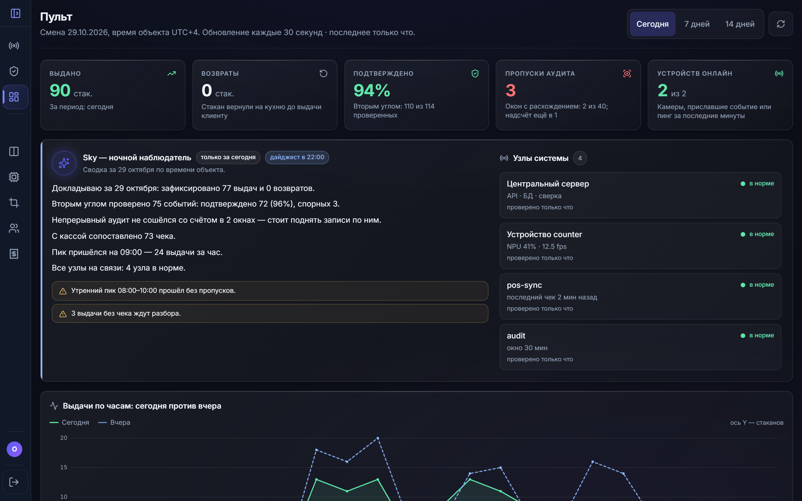

**Live counter** — edge camera stream with tracked cups inside the counting zone, plus device telemetry.

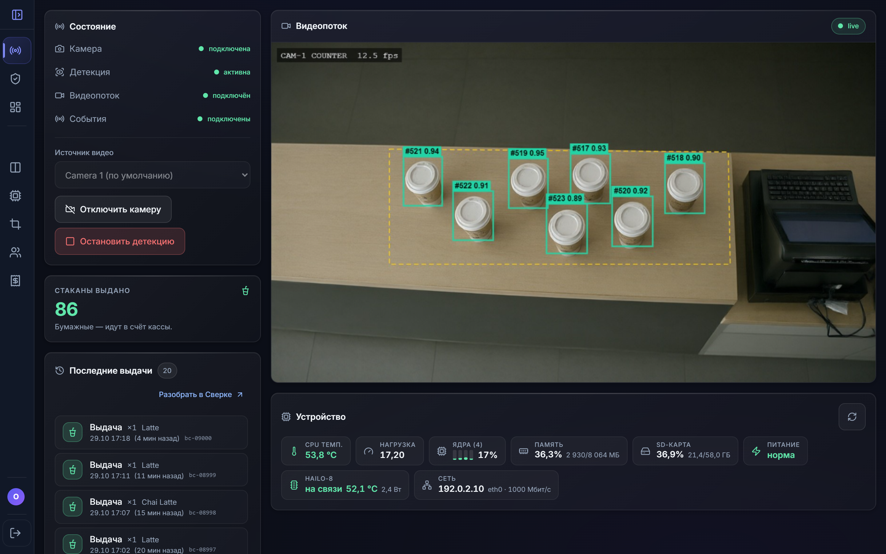

**POS vs camera by hour** — shift balance, receipt-to-hand-out delay and independent audit windows.

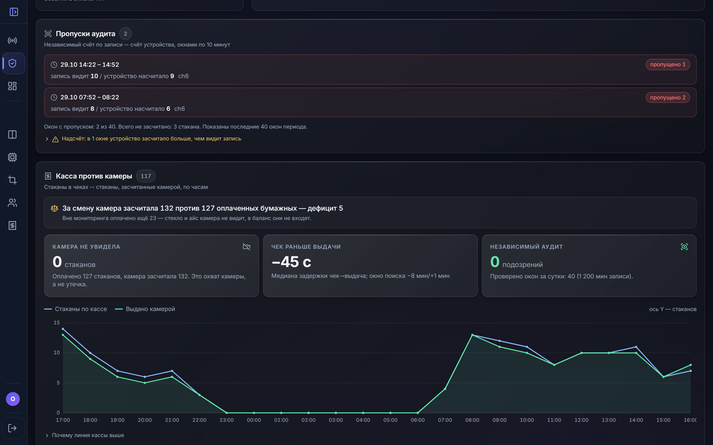

## Privacy

Video stays on your site. Only people you approve see the short clips; full recordings never leave your premises.

## Stack

Python · object detection (ONNX) and multi-object tracking · scenarios as configuration · OpenCV · FastAPI · React · PostgreSQL · edge accelerators (Hailo-8) · POS integration (iiko)

## Source code

Source code is private — demo on request.

## Contact

Zulfi Aliyev · alliyev.zulfi95@gmail.com · [sci-fi.az](https://sci-fi.az) · [LinkedIn](https://www.linkedin.com/in/zulfi-aliyev/)
