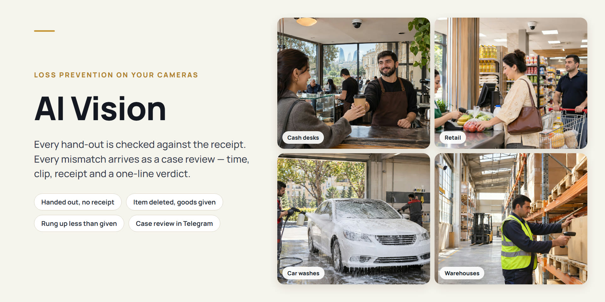
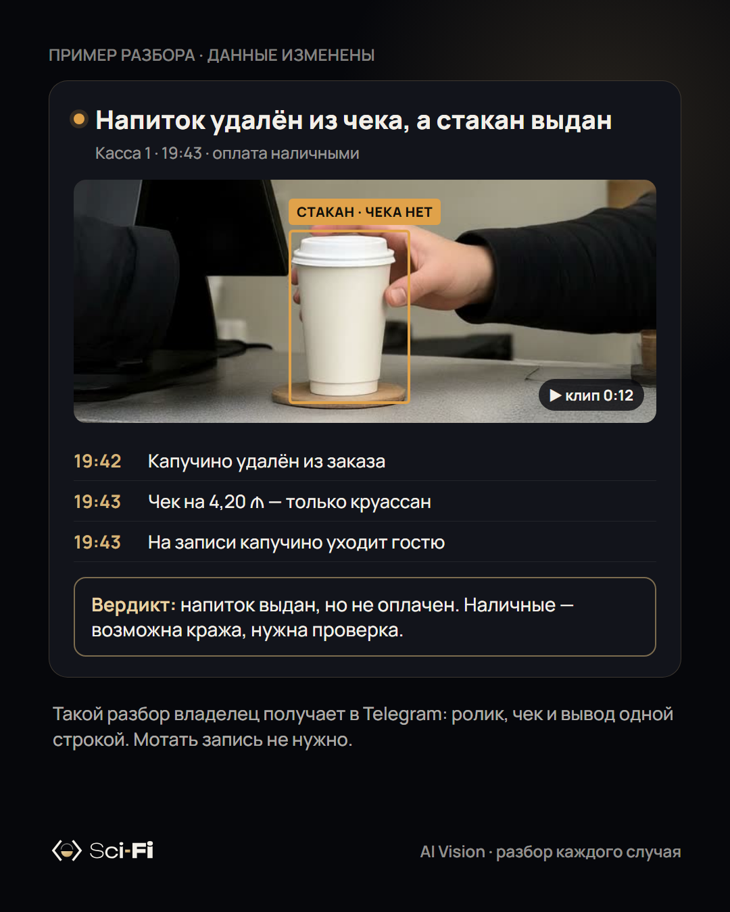
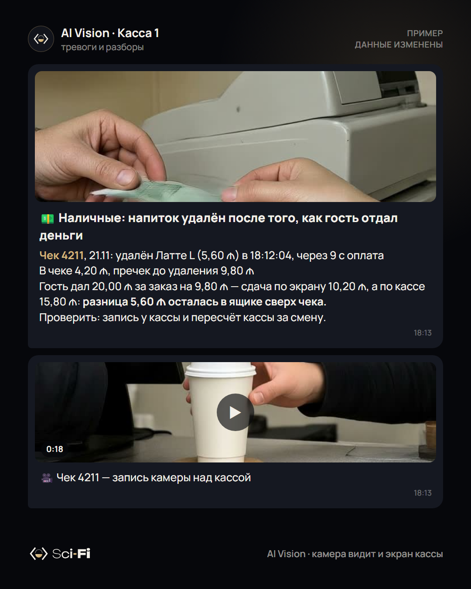
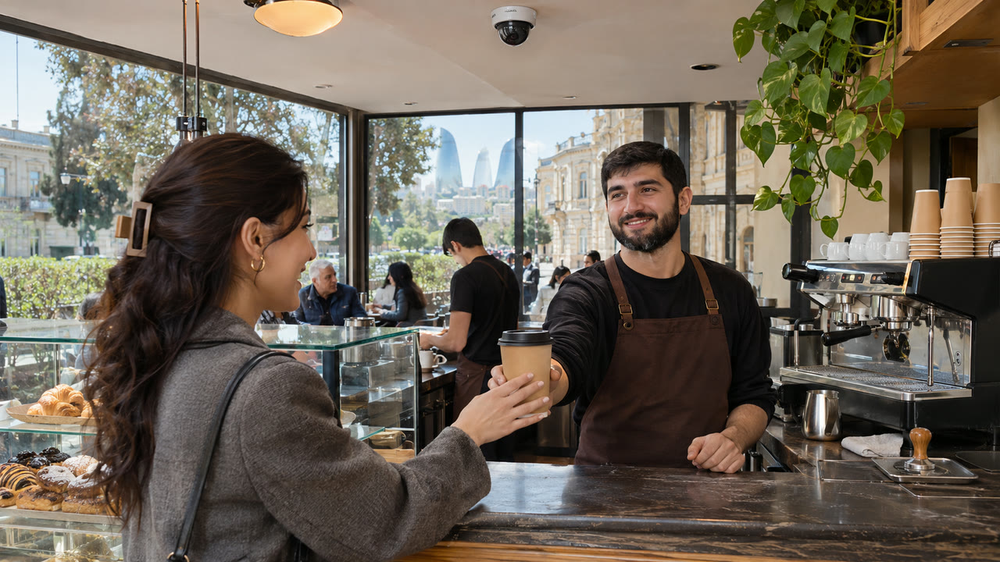
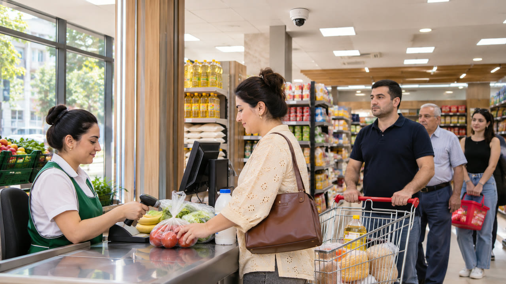
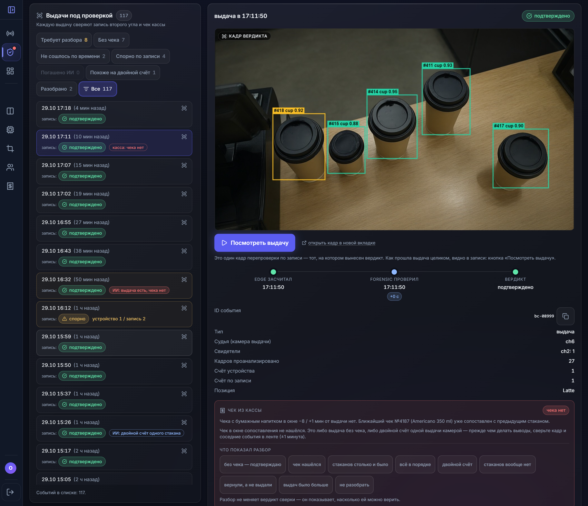
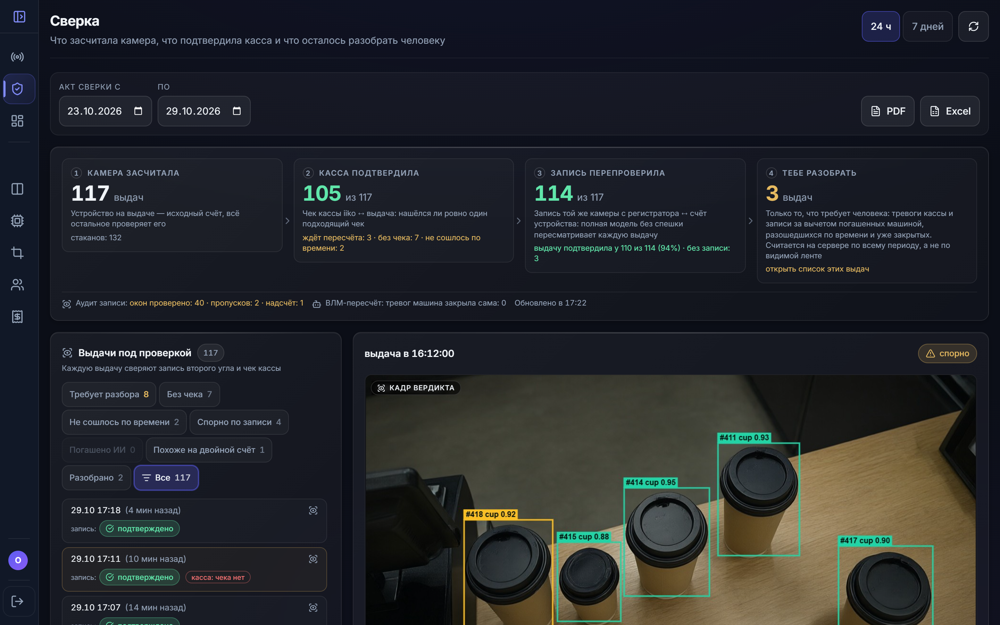
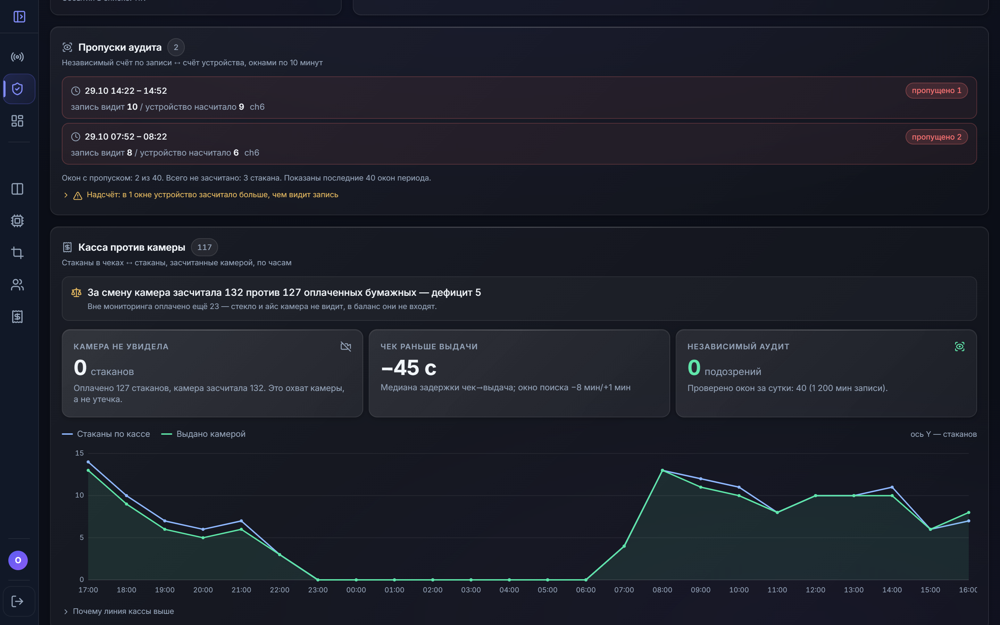
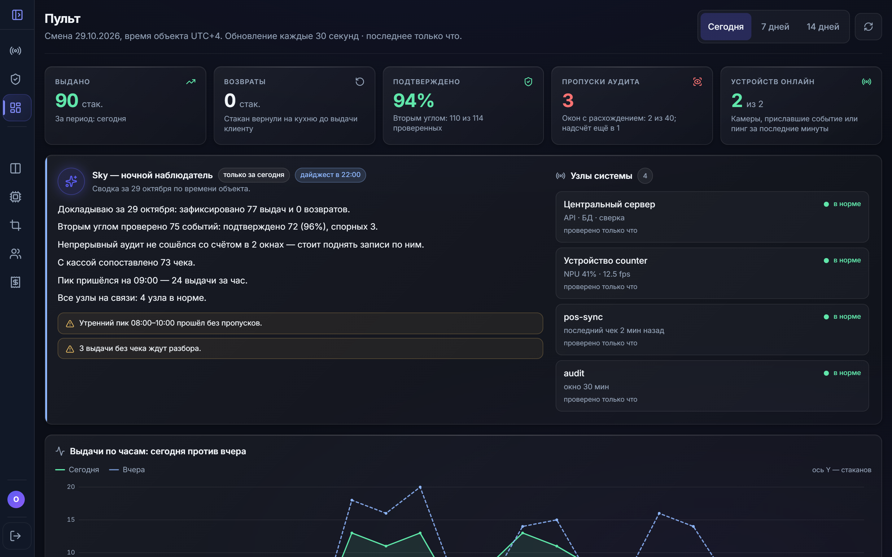
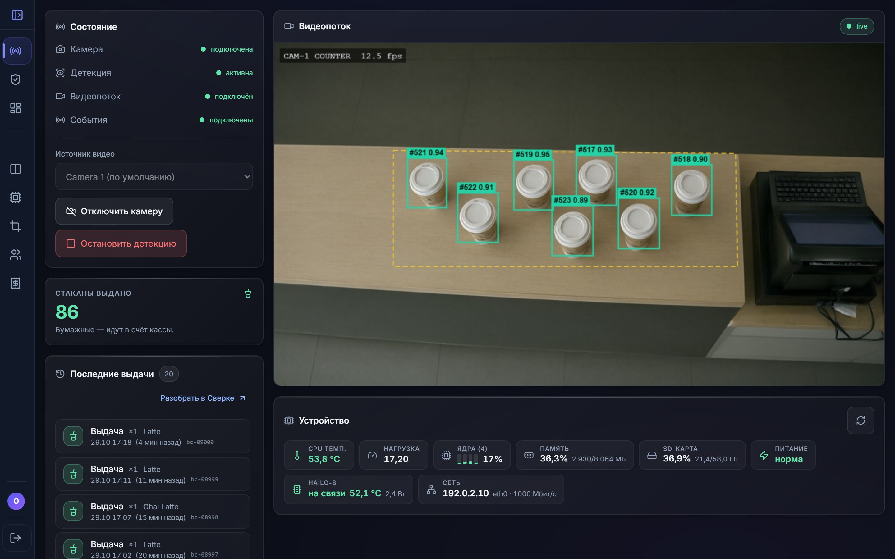

  

# AI Vision — money that leaves past the till, caught on your own cameras

**Every hand-out is checked against the receipt. Every mismatch reaches the owner in Telegram within minutes as an alert with a frame, the receipt and a short clip; ask "review receipt N" and get a one-line verdict.** No hours of footage to scroll through.

Running as a pilot at one operating café in Baku. Product page: [sci-fi.az/en/products/ai-vision](https://sci-fi.az/en/products/ai-vision)

## The schemes it catches

| Scheme | What the till shows | What the camera shows |
|---|---|---|
| Handed out, no receipt | nothing | a drink or item leaving the counter |
| Item deleted from the order, goods given anyway | a smaller receipt | the full order going to the guest |
| Rung up less than given | one item | two cups in the guest's hands |
| An extra cup written off at 0 ₼ | a "free" cup | a full drink in it |

Each one on its own can be an honest mistake. That is why a mismatch triggers an alert and a check, not an accusation.

## What a case review looks like

The owner's chat, as it works today (shown in Russian, example with changed data):

1. **Alert with a frame** — "Drink deleted from the receipt, but the cup was handed out": receipt number, payment type, what was deleted and what was paid, when the cup left.
2. **Clip** — the recording from the camera over the till, ready to play.
3. **Review on request** — "review receipt 4127": what the footage shows, what was paid, and a one-line verdict.

With cash, the camera also reads the till screen: if the guest handed over 20 ₼ and got less change than the till shows, the difference left in the drawer is in the alert.

## Honest by design

- **Not every alert is theft.** In the pilot most "handed out without a receipt" cases turned out to be paid — the receipt had been matched to the neighbouring hand-out. Punishing on every alert means punishing innocent people.
- **Money decides.** A card payment means the cashier could not have taken the money; with cash, the recording decides. "Theft" appears only where money and footage show it — otherwise the verdict is "not paid, check needed".
- **The system shows, the owner decides.** No face recognition: it sees "a person at the counter", not who that is.

## Beyond the café counter

We can test the same check — what left versus what was recorded — wherever goods or services leave against a receipt. Set up to order, tested on your footage before a pilot:

<table>
<tr>
<td width="50%"> <b>Cash desks</b> · <i>pilot</i> Hand-outs without a receipt, items deleted after hand-out, less rung up than given.</td>
<td width="50%"> <b>Car washes</b> Cars in the bay against receipts — 46 cars, 41 receipts is a question for the evening.</td>
</tr>
<tr>
<td> <b>Retail</b> Goods leaving the till against receipts, voids and returns at the counter.</td>
<td> <b>Warehouses</b> Pallets and boxes dispatched against the waybill.</td>
</tr>
</table>

Everything except the cash desk is set up to order: we look at your cameras, test on your footage and agree the cases that matter before a pilot. The same core also covers staff posts, queues, safety zones and other scenarios on request.

## How it works

1. **Your cameras** — new hardware only if the angle doesn't fit.
2. **Every hand-out counted** — the same object is tracked and counted once.
3. **Checked against the till** — each hand-out is matched to a POS receipt (iiko).
4. **Alert** — every mismatch goes to the owner in Telegram with a frame, the receipt and a clip, within minutes.
5. **Review on request** — a one-line verdict when the owner asks; the full shift is re-checked from the recording overnight.

## Screens from the first deployment

All screenshots use demo data for a fictitious café; camera frames are synthetic images without people.

**Discrepancy review** — a cup handed out without a receipt: verdict frame, receipt lookup and resolution.

**Reconciliation** — what the camera counted, what the till confirmed, what the overnight re-check confirmed, and what is left for a human to review.

**POS vs camera by hour** — shift balance, receipt-to-hand-out delay and independent audit windows.

**Owner dashboard** — today's hand-outs, second-angle confirmation, audit gaps, system health and the daily digest.

**Live counter** — camera stream with tracked cups inside the counting zone.

## Video and privacy

We process the video ourselves, on our own server in Baku — no third-party clouds or recognition services, no face recognition. Clips are seen only by the people the owner chooses. If video must not leave the premises at all, we install the processing node on site and only the cases go out.

## Stack

Python · object detection (ONNX) and multi-object tracking · scenarios as configuration · OpenCV · FastAPI · React · PostgreSQL · edge accelerators · POS integration (iiko) · Telegram

## Source code

Source code is private — demo on request.

## Contact

Zulfi Aliyev · alliyev.zulfi95@gmail.com · [sci-fi.az](https://sci-fi.az) · [LinkedIn](https://www.linkedin.com/in/zulfi-aliyev/) · [Sci-Fi on LinkedIn](https://www.linkedin.com/company/sci-fi-az/)
