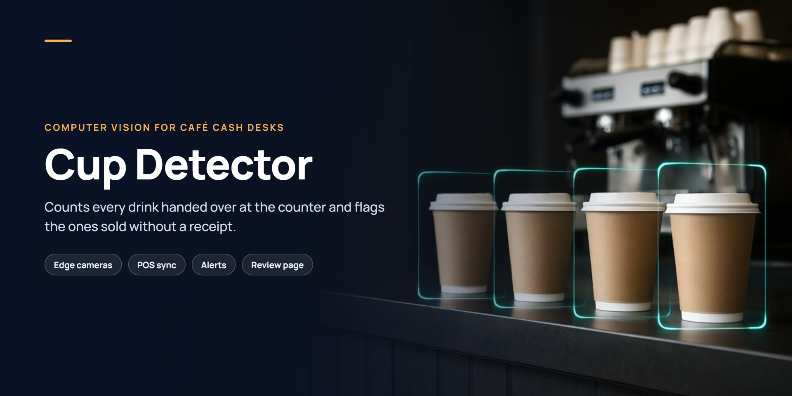
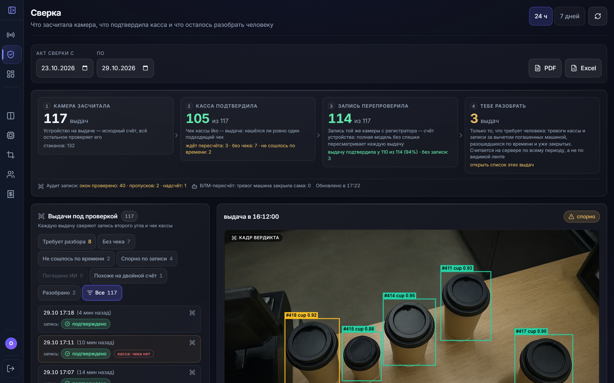
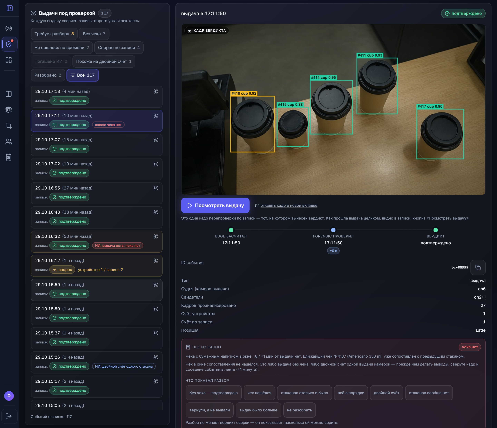
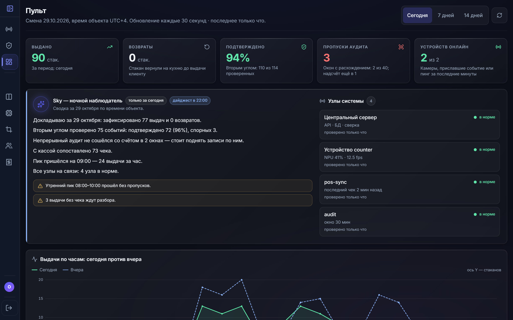
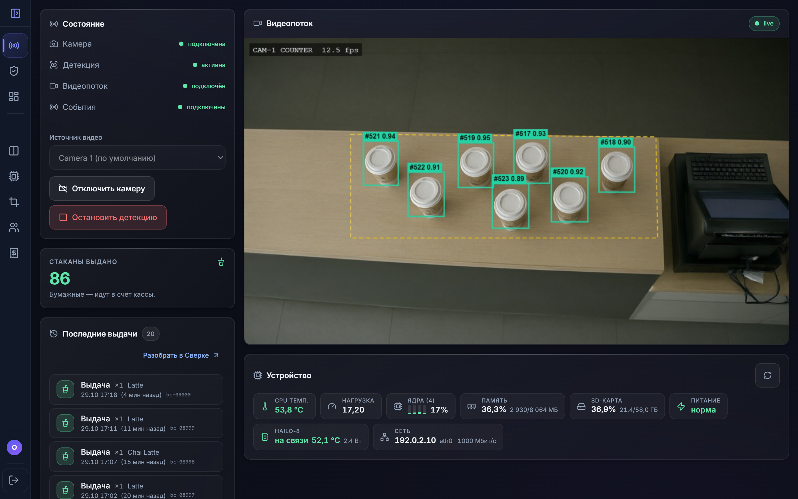
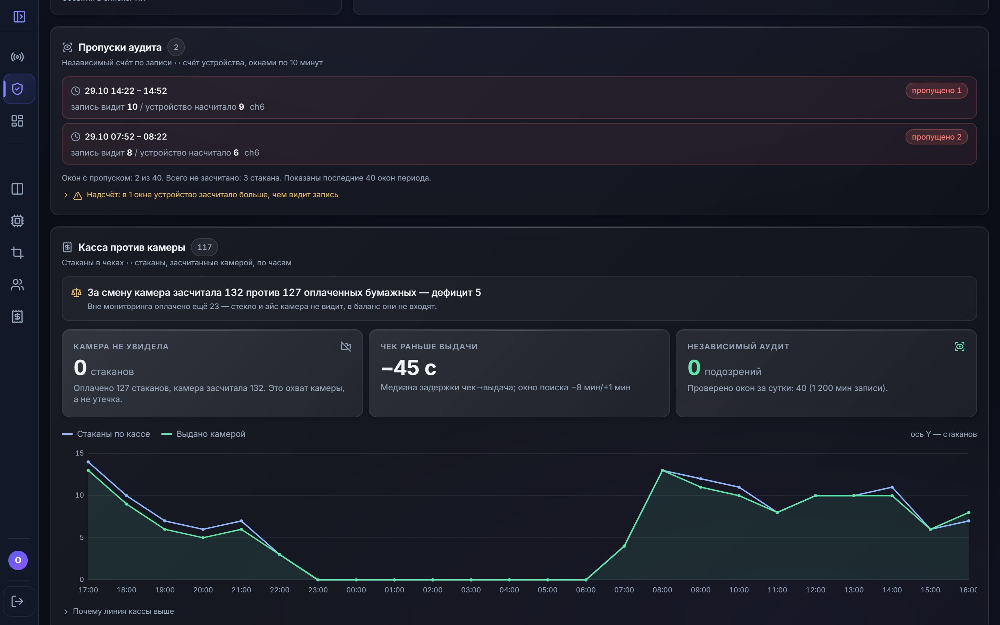

  

# Cup Detector

**Computer vision for café cash desks.** Cameras at the counter count every drink handed over to a customer, match each one with the receipts in the till and flag the drinks sold without a receipt. Piloted at a bakery-café chain.

## Who it's for

Cafés, coffee shops and bakery chains that want to control sales at the counter: owners and managers who need to know that every drink handed out was paid for — without watching hours of video.

## Key features

- **Counts every drink at the counter.** A camera above the hand-out zone recognises each cup given to a customer and tracks it through the counting zone.
- **Matches drinks with receipts.** Each hand-out is reconciled with the POS receipts in a time window around it.
- **Second-angle re-check.** A second camera recording is re-checked independently, so a single camera mistake does not become an accusation.
- **Alerts and a review page for every mismatch.** The owner gets an alert and opens the verdict frame, the receipt lookup and a one-click resolution for each disputed hand-out.
- **Owner dashboard and daily digest.** Today's hand-outs, confirmation rate, audit gaps, POS vs camera by hour and device health; reconciliation reports in PDF and Excel.
- **Custom-trained model on low-cost hardware.** The recognition model is trained on the site's own footage and runs on a small on-site device with an AI accelerator.

## Platforms

On-site edge device with cameras at the counter, a central server for reconciliation and audit, and a web dashboard for the owner.

## Screenshots

All screenshots use demo data for a fictitious café; camera frames are synthetic images without people. The interface is shown in Russian.

**Reconciliation** — what the camera counted, what the till confirmed, what the recording re-check confirmed, and what is left for a human to review.

**Discrepancy review** — a cup handed out without a receipt: verdict frame, receipt lookup and resolution.

**Owner dashboard** — today's hand-outs, second-angle confirmation rate, audit gaps, system health and the daily digest.

**Live counter** — edge camera stream with tracked cups inside the counting zone, plus device telemetry.

**POS vs camera by hour** — shift balance, receipt-to-hand-out delay and independent audit windows.

## Stack

Python · YOLO (custom-trained) · OpenCV · Hailo-8 edge accelerator · FastAPI · React · PostgreSQL · POS integration (iiko)

## Source code

Source code is private — demo on request.

## Contact

Zulfi Aliyev · alliyev.zulfi95@gmail.com · [sci-fi.az](https://sci-fi.az) · [LinkedIn](https://www.linkedin.com/in/zulfi-aliyev/)
